<div align="center">

# Agent Buddy

**A desk companion for AI coding agents: shows what Claude Code, Codex and DeepSeek Harness are doing, and how much quota is left, on a 4.3" ESP32-S3 pixel display.**

[中文](README.md) | English

[](LICENSE)


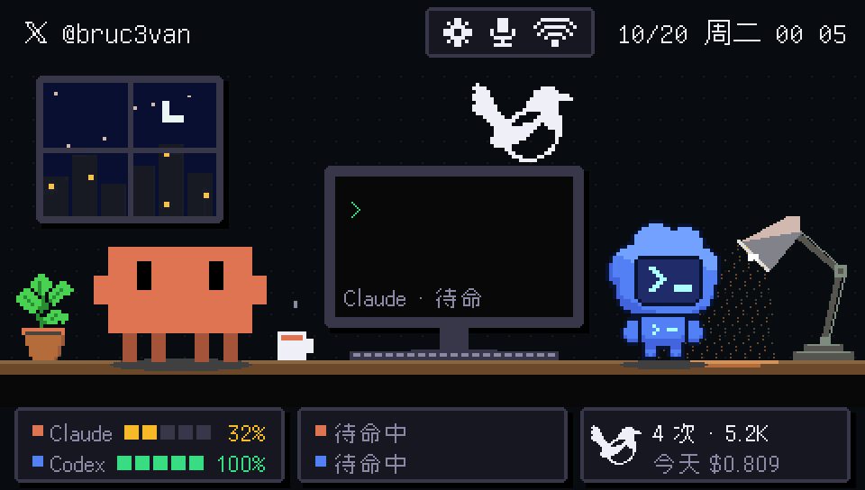

</div>

> The on-device UI and the detailed docs are in Chinese.

## Features

- **See what your agents are doing at a glance**: Claude's Clawd and Codex's cloud robot sit at a pixel-art desk, and DeepSeek's little whale lives in a fish tank on the wall. Each has its own animation for thinking, writing code, running commands, waiting for your approval, done and error. The screen border flashes while an agent waits for you.
- **Quota at a glance**: 5-hour and 7-day remaining quota for Claude Code and Codex, with reset times; DeepSeek is pay-as-you-go, so it shows your balance, its trend and today's usage (from magpie).
- **[magpie](https://github.com/yetone/magpie) panel**: the four pages of magpie's menu bar panel (Agents / Quotas / Usage / Routes). The magpie flaps its wings when a new request comes in, and routed requests fly across the Routes page.
- **Sound**: 8-bit notification sounds and optional spoken alerts ("Claude needs your approval: git push", "Task done in 3 minutes"). With a microphone, Clawd sways to music and goes quiet while you talk.
- **Knows when you're there**: with a mmWave radar, it switches to a standby clock when you leave your seat, greets you when you come back, and tells you when someone stops behind you.
- **Works without the cable**: once the board is on Wi-Fi, unplugging USB switches the link to Wi-Fi (mutual authentication + AES-256-GCM). Several computers can be paired, using a 6-digit code shown on screen.
- **One-command setup** on macOS and Windows: installs, flashes the prebuilt firmware and registers hooks. No Arduino install needed.

## Screenshots

Captured directly from the board (480×272, scaled 2×).

| | |
|:---:|:---:|
| 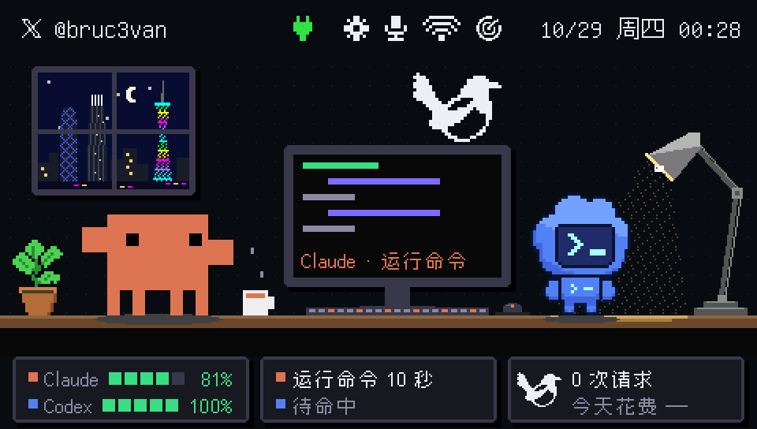<br>Desk scene: the monitor shows Claude's current state; quota, status and today's magpie usage along the bottom | 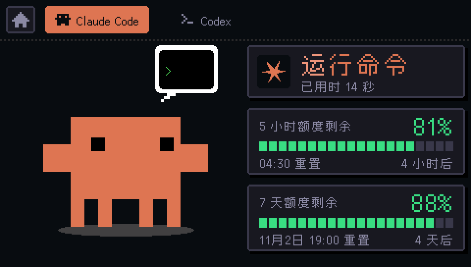<br>Claude Code running a command, with 5-hour / 7-day quota |
| 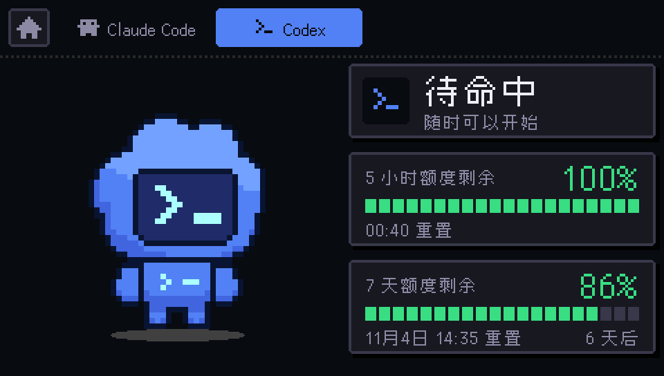<br>Codex, idle | 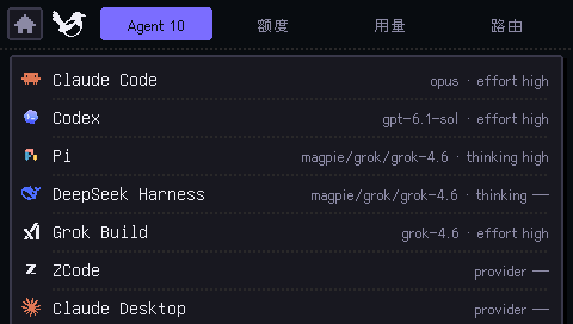<br>magpie · Agents: model and reasoning effort per agent |
| 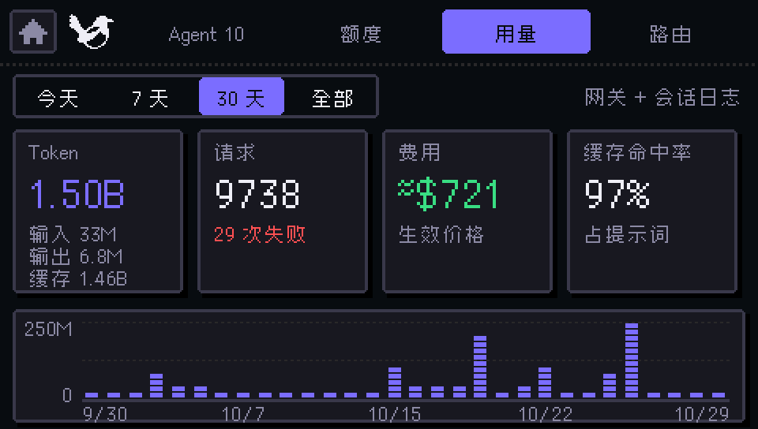<br>magpie · Usage: tokens, requests, cost, cache hit rate | 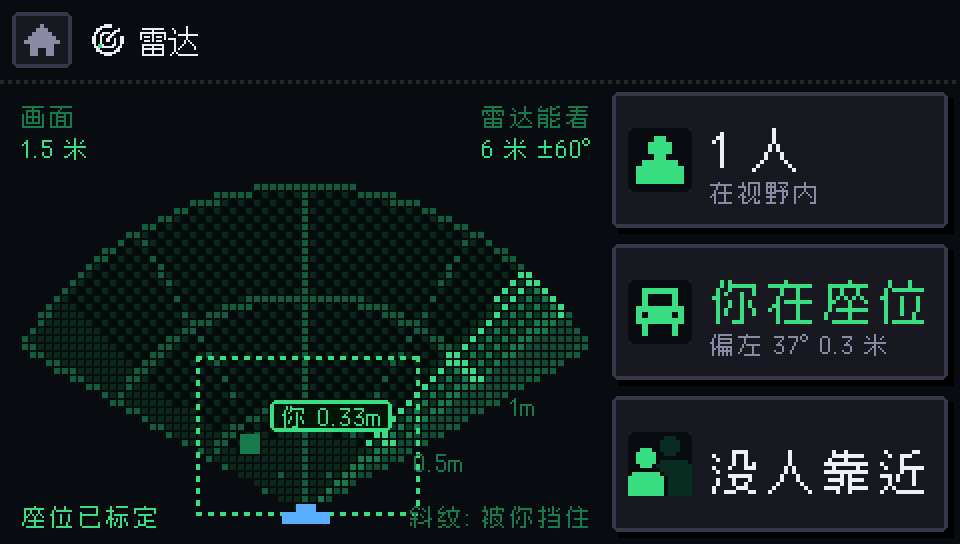<br>Radar: you at your seat, your blind spot, anyone approaching |
| 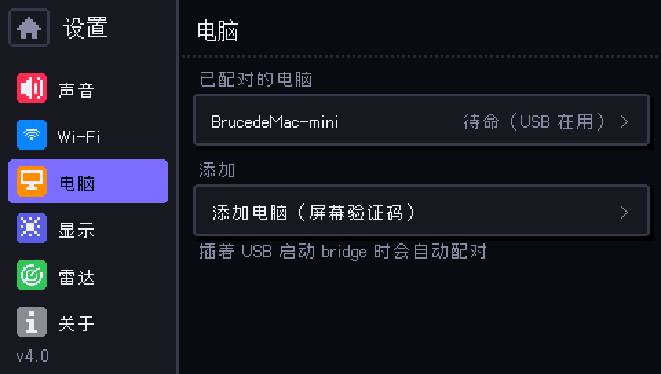<br>Settings · Computers: paired computers and which one is in control | 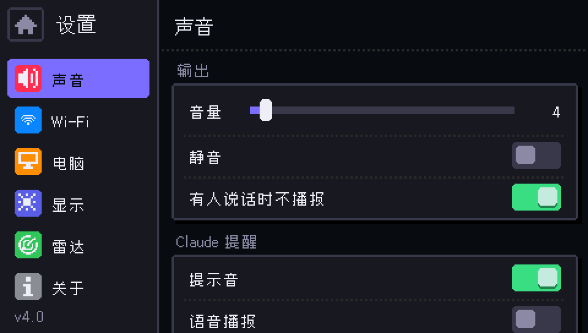<br>Settings · Sound: volume, sound effects, spoken alerts |

## Photos

| | | |
|:---:|:---:|:---:|
| 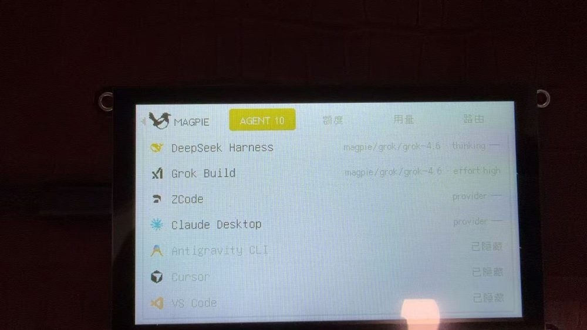<br>The magpie Agents page on the real screen (early light theme) | 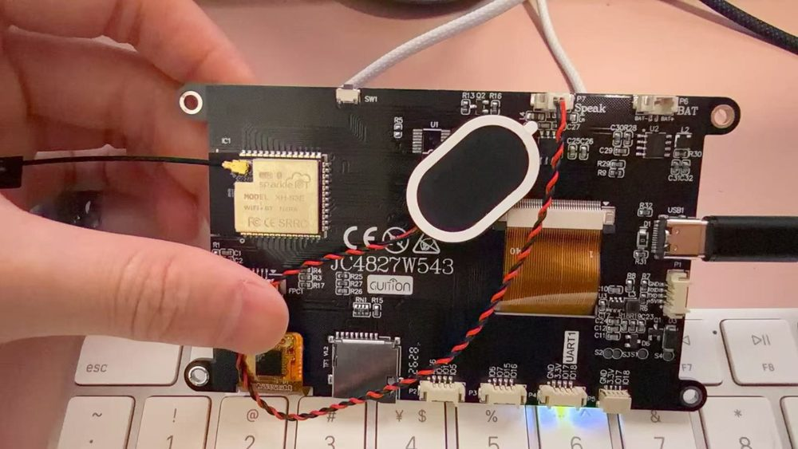<br>Back of the board: ESP32-S3 module, external antenna, 2030 speaker on the Speak port | 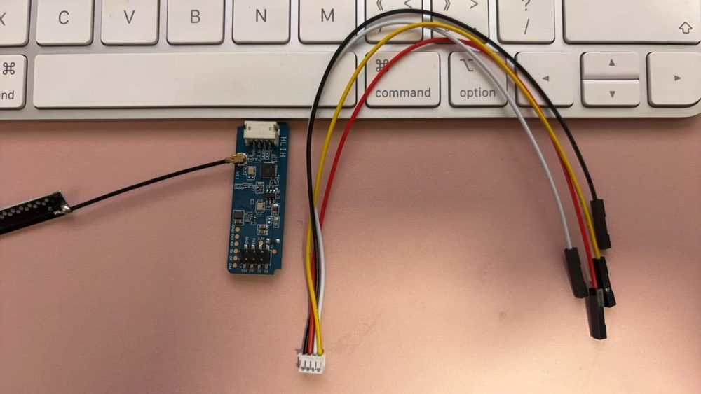<br>HLK-LD2450 mmWave radar and its cable |

## 3D-printed case

A pixel-style mini TV, fully snap-fit: no screws, no glue. The same STL files give two color schemes, just swap filaments:

| Classic black & grey | Cream × Claude orange |
|:---:|:---:|
| 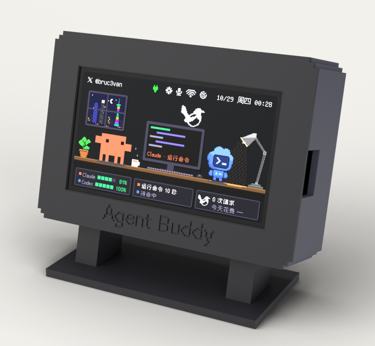<br>Black bezel and stand, dark-grey body and back | 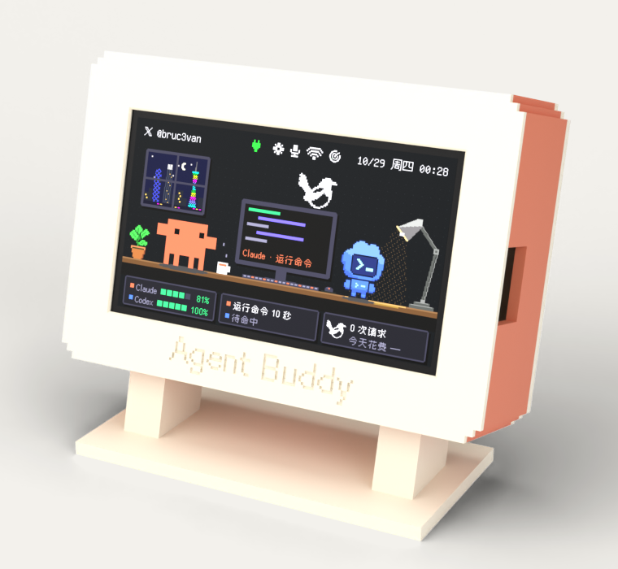<br>Cream bezel, back and stand, Claude-orange body ([three views](case/preview/theme-cream-views.png)) |

## Bill of materials

These are the exact parts the author bought. Prices are what was paid on Pinduoduo (a Chinese marketplace) in October 2026, shipping mostly included, for reference only. Similar parts are easy to find on AliExpress with the same search terms.

**Required**

| Part | Search term | Variant to pick | Price | Purpose |
|---|---|---|---:|---|
| Guition 4.3" ESP32-S3 touch display | `JC4827W543` | Capacitive touch (`JC4827W543C`), ESP32-S3 N4R8 | ¥99 | Board + display: 480×272 NV3041A QSPI panel, GT911 capacitive touch, on-board I2S amplifier and Li-ion charger |
| USB-C cable | — | Must carry data (some cables are charge-only) | — | First setup and flashing; the link can move to Wi-Fi afterwards |

**Optional**

| Part | Search term | Variant to pick | Price | Connects to | Purpose |
|---|---|---|---:|---|---|
| mmWave radar | `HLK-LD2450` | Test kit A: module + cable + antenna | ¥28.2 | **P1** | Seat presence, people behind you |
| Microphone | `INMP441` | Headers pre-soldered | ¥15.8 | **P3** (power from **P4**) | Music beats, whether you are talking |
| Speaker | `2030 speaker` | 2030 oval, 8Ω 0.5–2W, **2-pin 1.25mm plug**, 160mm lead | ¥5.4 | **Speak** | Sound effects and spoken alerts |
| Li-ion battery | `603450 lipo` | 3.7V 1200mAh, **1.25mm 2-pin plug** | ¥13.86 | **BAT** | Runs without USB; charges while USB is plugged in |
| Adapter cables | `MX1.25 4P to Dupont` | 20cm, pack of 5 | ¥10.56 | P1 / P3 / P4 | Turn the board's 1.25mm ports into Dupont headers for the mic and radar |
| Dupont wires | `Dupont wire 20cm` | Male-to-male, strip of 10 | ¥2.47 | — | Join the radar kit cable (female) to the adapter cable (female) |

Optional parts total about **¥76** (≈ US$11); with the board, the full set is about **¥175** (≈ US$25). The case can be 3D-printed ([two color schemes](#3d-printed-case)), about 160 g of PLA in total; STL files are in [`case/stl/`](case/stl).

Notes:
- **Check the battery polarity before plugging it in** — some sellers wire red / black the opposite way from the board's BAT port. Press **SW1** on the board once to power on.
- Swapped radar TX / RX is fine; the firmware tries both.
- Everything optional can be left out: no speaker means no sound, and without a microphone or radar it falls back to keyboard / mouse idle time on your computer. Pin-outs are in the [manual (Chinese)](docs/使用手册.md#配件接线可选).

## Quick start

1. Connect the board to your computer with a USB-C **data** cable.
2. Download this repository and run the setup:
   - **macOS**:
     ```bash
     ./setup.sh
     ```
   - **Windows**: double-click `setup.cmd` in the repository root.
3. Answer a few questions (all have defaults). When it finishes, a "welcome back" test notification pops up on the screen.
4. Restart any running Claude Code / Codex / dsh sessions so the hooks take effect.

Setup creates the Python environment, registers the Claude Code / Codex / DeepSeek Harness hooks, detects the board, flashes the prebuilt firmware from `firmware/` if needed, enables autostart, then starts the bridge and checks it. It is safe to run again; finished steps are skipped. `~/.claude/settings.json`, `~/.codex/config.toml` and `~/.dsh/cordis.patch.yml` are backed up before they are changed.

### Unplug USB, use Wi-Fi

Join a network under Settings → Wi-Fi on the board. Starting the bridge with USB plugged in pairs automatically; after that, unplugging the cable switches to Wi-Fi, and plugging it back in switches back to USB. To pair a computer that has no USB connection (a second computer, for example):

1. On the board, open Settings → 电脑 (Computers) → 添加电脑 (Add computer).
2. On the computer, run:
   ```bash
   bridge/buddy pair --wifi
   ```
3. Check that the 6-digit code matches on the board and in the terminal, then tap 允许 (Allow) on the board.

## How it works

```
Claude Code ─hooks / statusline─┐
Codex ──────hooks───────────────┤
DeepSeek Harness ─hooks─────────┼─▶ bridge (on your computer, 127.0.0.1:47823) ══ USB or Wi-Fi ══▶ ESP32-S3 display
magpie local gateway ◀─read-only┘     merges session state, quota, usage                          animations / quota / panels
```

- The **bridge** (`bridge/agent_bridge.py`) runs on your computer. It receives Claude Code / Codex / DeepSeek Harness hook events and statusline quota, reads magpie's read-only local API, and sends the result to the board. It only listens on localhost and never reads any login credentials; the one exception is a DeepSeek API key you choose to provide, which it uses only to look up your account balance.
- The **firmware** (`agent_buddy/`) handles drawing, touch, sound, radar and the Wi-Fi link.
- **Link**: USB when plugged in, Wi-Fi otherwise (TCP 47824; HMAC mutual authentication, then every frame encrypted with AES-256-GCM). On macOS the board connects to the computer; on Windows the computer connects to the board, so neither needs firewall changes. Design notes (Chinese): [无线通讯方案](docs/无线通讯方案.md).

## Commands

Everything goes through `bridge/buddy` (`bridge\buddy` on Windows):

| Command | What it does |
|---|---|
| `buddy status` | Checks the process, link (USB / Wi-Fi), firmware version, hooks and magpie |
| `buddy start` / `stop` / `restart` | Start / stop / restart the bridge |
| `buddy logs -f` | Follow the log |
| `buddy flash` | Flash the prebuilt firmware (`--build` compiles the current code first) |
| `buddy pair --wifi` | Pair over Wi-Fi with the on-screen code |
| `buddy record 30` / `snap` | Record the screen for 30 s / take a screenshot |
| `buddy uninstall` | Stop, disable autostart, remove hooks |

## Documentation (Chinese)

- [使用手册 (Manual)](docs/使用手册.md): every feature in detail — state animations, sound, radar rules, standby clock, battery, debug endpoints, building the firmware yourself.
- [无线通讯方案 (Wireless design)](docs/无线通讯方案.md): Wi-Fi protocol, pairing, security and multi-computer rules.
- [打印说明 (Printing)](case/打印说明.md), [组装清单 (Assembly)](case/组装清单.md)

## Layout

```
agent_buddy/   firmware (Arduino, ESP32-S3)
bridge/        computer side: bridge daemon, buddy CLI, hooks
firmware/      prebuilt firmware used by buddy flash
case/          3D-printed case: parametric model and STLs
docs/          manual, design notes, README images
tools/         scripts that generate the magpie animation frames and brand icons
promo/         Blender scenes and compositing scripts for the promo video
touch_test/    minimal screen + touch test sketch
setup.sh / setup.cmd   one-command setup
```

## Acknowledgements

- [magpie](https://github.com/yetone/magpie): the data source and design reference for the panel.
- Clawd and the Codex pet are modelled on Anthropic's and OpenAI's official characters, and the whale on DeepSeek's logo; brand icons belong to their owners.
- The firmware uses [Arduino_GFX](https://github.com/moononournation/Arduino_GFX), [U8g2](https://github.com/olikraus/u8g2), [TAMC_GT911](https://github.com/TAMCTec/gt911-arduino) and [ArduinoJson](https://github.com/bblanchon/ArduinoJson).

## License

The code is released under the [MIT License](LICENSE). Claude, Codex, DeepSeek, magpie and related names, logos and characters belong to their respective owners and are not covered by this license.
