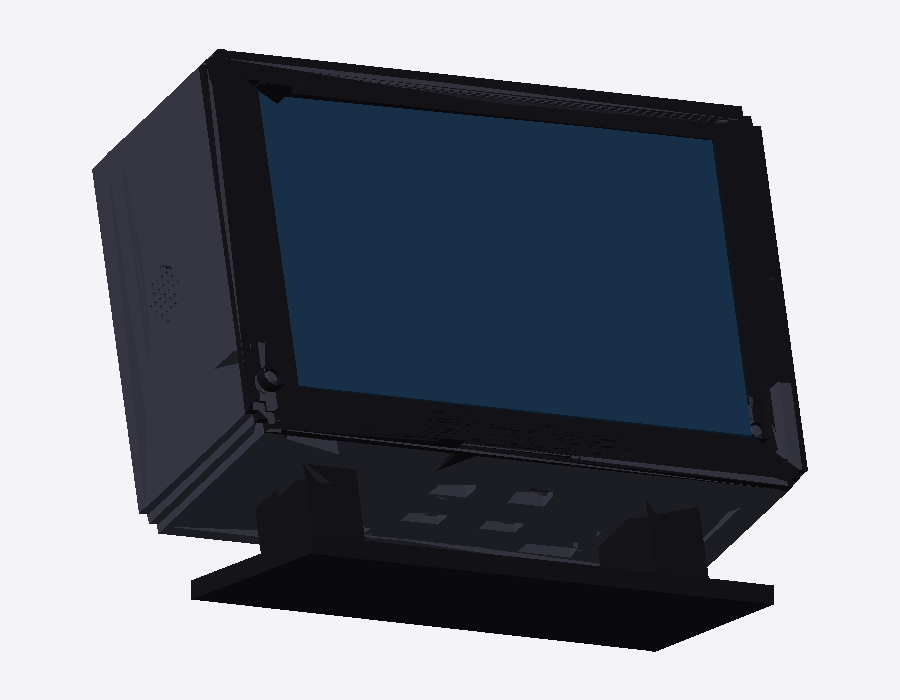
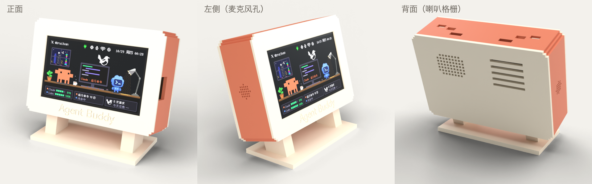

# Agent Buddy 外壳 · 打印说明

像素风小电视外壳，给一块 4.3 寸 ESP32 触摸屏（JC4827W543）用。STL 都在 `stl/` 文件夹里，已经按推荐的打印方向摆好，导入切片软件直接用就行。整个外壳**不用螺丝、不用胶**，全部靠卡扣。

## 零件

| 文件 | 颜色 | 数量 | 约用量 | 尺寸（mm） | 摆放 / 支撑 |
|---|---|---|---|---|---|
| `1-前框-黑.stl` | 黑 | 1 | 17 g | 130 × 89 × 20 | 正面朝下，卡扣朝上，不用支撑 |
| `2-机身-深灰.stl` | 深灰 | 1 | 55 g | 130 × 89 × 35 | 后口朝下，不用支撑 |
| `3-后盖-深灰.stl` | 深灰 | 1 | 49 g | 130 × 89 × 21 | 外面朝下，卡扣朝上，不用支撑 |
| `4-支架-黑.stl` | 黑 | 1 | 40 g | 108 × 37 × 52 | 底板朝下，不用支撑 |

合计约：黑 58 g、深灰 104 g。

## 配色

同一套 STL，换耗材颜色就行。文件名里的颜色是经典配色。

| 零件 | 经典黑灰 | 米白 × Claude 橙 |
|---|---|---|
| 前框 | 黑 | 米白 |
| 机身 | 深灰 | Claude 橙（`#D97757`） |
| 后盖 | 深灰 | 米白 |
| 支架 | 黑 | 米白 |
| 合计 | 黑 58 g、深灰 104 g | 米白 106 g、橙 55 g |

米白和橙色都建议用**哑光 PLA**：白色亮面 PLA 容易显得发灰。橙色按色卡挑最接近 `#D97757` 的（偏砖红的赤陶橙，不是亮橙）。前框正面的「Agent Buddy」刻字在米白上不太显眼，能多色打印的话把字换成橙色。

## 推荐参数

- 材料：**PLA**（PETG 也行，卡扣更耐反复拆装）
- 层高 0.2 mm，墙 3 层，顶 / 底 4 层，填充 15–20%
- 喷嘴 0.4 mm
- 三个大件建议加 Brim，防止翘边

## 注意

- 前框和后盖上各有四个卡扣悬臂（1.8 mm 厚、18 mm 长，上下沿各两个），切片时**墙数保持 3 层以上**，悬臂才是实心的，不容易断。
- 机身左右内壁各有两根弹簧托台的横梁（1 mm 厚、约 14 mm 长的平桥），切片时保持默认的桥接设置就行，**不要加支撑**，否则横梁会被支撑粘住、失去弹性。
- 前框正面下方有一行凹刻的像素字 `Agent Buddy`（0.6 mm 深）。如果能多色打印，可以把最底下几层的字换成浅色；不能就保持原样。
- 唇边和机身内壁之间留 0.15 mm，其他配合留 0.25 mm。偏紧可以用砂纸磨一下唇边外圈。
- 机身打出来应该是**一整块**方管。如果切片软件里显示成几块分开的墙板，说明用的是旧版 STL（四个角的墙是断开的），请换成新的。
